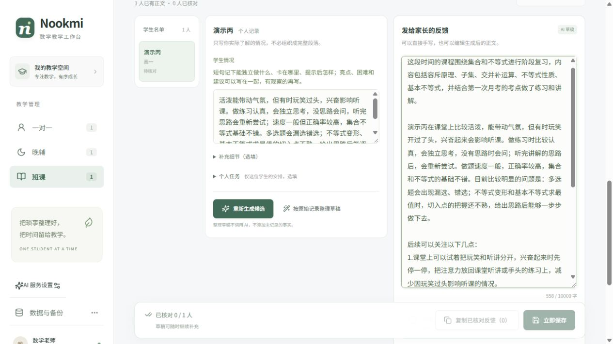
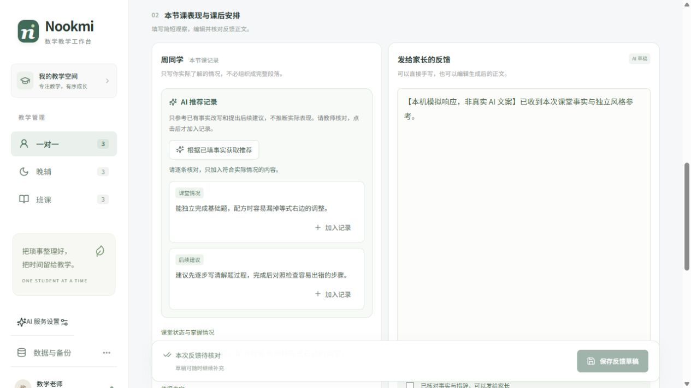
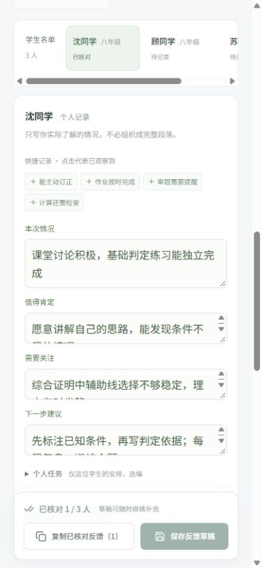

# Nookmi

**让数学教师少花时间组织语言，多保留对每位学生的具体观察。**

当前版本 **v0.6.1** 支持优先采用教师自己的反馈风格；未设置个人范文时，使用六份精选匿名范例提供的三模块默认写法。一对一默认标题图标适度搭配变化，保留清晰的内容层次。输入仍是简短真实记录，不增加必填项；停笔后自动保存，生成后核对、修改并复制给家长。前端采用 React / TypeScript，后端采用模块化 Python / FastAPI，正式资料保存在本机 SQLite。



查看 [三个模块的实际输入与生成结果](docs/GENERATION_EXAMPLES.md)，以及 [测试记录与效果边界](docs/VERIFICATION.md)。

v0.6.1 的自然段、短分点、自定义标题和图标搭配效果见 [个人风格实测示例](docs/STYLE_EXAMPLES.md)。

<details>
<summary>查看更早版本的历史界面参考</summary>





</details>

## 三种反馈流程

| 模块   | 周期                           | 填写方式                                                 |
| ------ | ------------------------------ | -------------------------------------------------------- |
| 一对一 | 一名学生的每次课程，可选择上课时间 | 本节课内容、课堂状态与掌握情况、亮点、困难、建议和课后任务 |
| 晚辅   | 每周，默认周一至周五，可修改   | 共用背景写一次；逐人记录作业、习惯、心态及分科学习情况   |
| 班课   | 每月，默认当月起止日期，可修改 | 共用阶段教学总结；逐人补充课堂表现、练习与掌握情况、建议 |

- 在「课堂状态与掌握情况」或「学生情况」主框中混写真实要点即可，亮点、困难和建议不必逐栏填写；也可以直接手写正文。
- 「补充细节」是选填项，需要时再展开。已有分项记录会自动展开显示，旧内容不会隐藏或丢失。
- 新建反馈默认「按范文完整展开」，按真实信息多少决定篇幅，不统一限制在 250–400 字；资料少时简写，也可选择「简短，抓住重点」。已有反馈保留原篇幅选择。
- AI 提示词按语义区分真实表现和未来建议；即使混写在同一个框中，也要求把“打算”“下次准备”保留为计划，不能改成已完成的事实。
- 一对一只有一个「课后任务」输入框。旧版两处任务记录会在打开反馈时合并显示，保存后保留为统一任务；历史反馈正文不变。
- 晚辅初二默认数学、物理，初三默认数学、物理、化学，科目可自行调整。
- 班级批量生成只处理“有个人事实、尚无正文”的学生；失败可重试，已完成内容保留。
- 重新生成先展示候选与现有正文，接受后才替换；生成期间修改记录时，旧响应不会覆盖新输入。
- 原始记录、反馈正文、核对状态分别保存。只记录情况而暂不生成，也会自动保存草稿。
- 核对后可复制某位学生，或批量复制已核对的反馈。程序不会自动发送给家长。
- 学生、班级、批量录入、个人档案与教学笔记继续保留；历史反馈按最近编辑优先展示。

**AI 服务尚未配置时**，可以保存记录、手写正文，或使用明确标注的“按原始记录整理草稿”。后者不调用 AI，不会把关键词扩写为模型文案。

### 精选范文如何改善生成

每个模块内置两组“简短记录 → 目标反馈”示例，共六组，供未设置个人范文时使用。选择互补的教学场景：一对一综合练习与专项练习，晚辅分科方法与基础起步，班课提示后继续与知识应用不熟。范例已匿名化，短输入由认可成稿逆向提炼，仅用于写法校准。具体选材理由见 [反馈写作标准](docs/WRITING_STANDARDS.md)。默认结构如下；有个人范文时优先使用该教师的写法。

- 一对一按学习内容、表现与掌握、后续建议和实际作业组织；图标只用于段落标题，按课程信息稳定选用语义匹配的一组搭配，没有实际作业记录时不编写作业。
- 晚辅采用紧凑周反馈，只写有观察的学科，结合习惯与作业情况给建议。
- 班课采用共用阶段概述、个人分析和编号建议；共用概述可以一致，个人困难不能从范文或其他学生处补入。

生成要求区分独立完成、稍加提示后继续、讲解后订正等掌握层次，保留具体卡点和不确定判断，并让建议回应这些问题。教师仍只点击一次生成，后台先生成初稿，再按当前记录复核事实、掌握程度和学科建议；正常每位学生会调用同一配置模型两次，费用和等待时间相应增加，批量生成按学生逐个处理。

自动复核不保证正确，仍需教师核对。若第二次调用失败，系统保留初稿并明确提示「自动检查未完成」，不会把结果标为已核对，也不要求重新填写记录。

### 输入保护与自动保存

反馈输入会立即暂存在当前浏览器。日期、学科等填写有效且有实际内容时，停笔约 **1 秒**自动保存到 SQLite，也可点击保存按钮。页面会区分本机暂存、正在保存和已存入数据库；自动保存不会调用 AI 或发送消息。

日期暂时未填完整、后端离线或保存失败时，本机草稿仍保留。保持页面开启，普通保存失败后约 **15 秒**重试；修正无效字段后继续自动保存。刷新后回到原来的学生或班级，可恢复尚未同步的内容。

数据库版本冲突会暂停保存，避免覆盖其他页面的更新。处理冲突时，可以保留本机文字并另存为新反馈，或明确采用数据库版本。

**本机草稿只属于同一浏览器、同一地址。** `localhost` 与 `127.0.0.1`、不同端口的草稿不共享；清除浏览器数据会删除未同步的草稿。若页面提示无法暂存，应先复制文字留存。SQLite 和已导出的备份用于正式资料保存。

### 个人风格参考

展开「个人风格参考」，选填 1–3 份体现自己写法的满意反馈（先去掉姓名等身份信息），点击「保存风格参考」。后续生成优先学习你的结构、语气、篇幅和图标习惯：可以是自然段、带小标题或编号的写法，也可以完全不用图标；不再同时套用内置成对示例和固定模块格式。每个模块独立保存，同模块的学生或班级自动复用，无需每次填写；留空或清空后保存则回到内置默认标准。这不是模型训练，而是在每次生成时提供写作范例。

一对一使用图标的个人风格可以采用含义相近的搭配变化；范文不用图标时不强加图标。图标用于帮助阅读，不能代替具体观察；没有对应内容的板块直接省略，不为凑齐结构补写。选择「简短，抓住重点」时仍会压缩篇幅。

风格范文编辑时也会本机暂存，刷新后可恢复，但**必须点击「保存风格参考」才更新数据库并用于 AI**。可撤销修改，或清空后保存以移除参考；数据库中的范文已有更新时，不会静默覆盖本机输入。

个人风格优先只影响写法；真实事实、掌握程度与学科建议的正确性始终优先。本次学生的表现、知识点和任务仍以本次真实记录为依据，不沿用范文中的事实，也不执行范文中的指令。参考有未保存修改时，先保存或撤销再生成；修改参考不会覆盖已有反馈正文。v0.5.0 已移除「AI 推荐记录」，保留完整反馈正文生成。

## 在本地使用

需要已安装 **Node.js 22.12+** 和 **Python 3.10+**；项目使用 Node.js 24、Python 3.12 开发。

首次获取并准备环境：

```bash
git clone https://github.com/Eternity-Top-down/Nookmi.git
cd Nookmi
npm ci
npm run setup:backend
npm run start
```

打开 [本地工作台](http://127.0.0.1:5173/)。保留启动窗口，按 `Ctrl+C` 停止。Windows 启动器会清理自己创建的前后端子进程树，避免虚拟环境的 Python 子进程遗留并继续提供旧接口；不会按进程名终止其他 Python 或 Node 程序。

已有环境时，只需在项目目录执行 `npm run start`。Windows 也可以双击 **启动工作台.cmd**，再打开上面的地址。日常使用不需要编辑 TypeScript 或 Python。

### 更新后重新启动

**更新代码后，需要停止并重新启动 Python 后端。** 浏览器刷新或前端热更新不会让正在运行的后端自动载入新接口。

1. 先保存当前记录；如果保存失败，先复制未保存的文字到本地文本文件留存。
2. 在原来的启动窗口按 `Ctrl+C` 停止工作台；如果分别启动前后端，也要停止旧的后端窗口。
3. 在项目目录更新代码；依赖有变化时执行 `npm ci` 和 `npm run setup:backend`。
4. 重新执行 `npm run start`，或双击 `启动工作台.cmd`，待启动完成后刷新页面。

启动前会检查端口是否占用，启动后核对后端的服务标识与版本。如果提示版本不匹配或端口占用，请找到仍在运行的旧工作台窗口并停止，再重试；反复打开新窗口不会更新旧进程。开发排查时可查看 [后端健康状态](http://127.0.0.1:8000/api/health) 的 `version`，应与当前项目版本一致。

`setup:backend` 会在项目内建立 `.venv`，不修改全局 Python 包。如果系统找不到 Python，可在 PowerShell 中先指定已安装的解释器：

```powershell
$env:NOOKMI_PYTHON = "E:\你的Python目录\python.exe"
npm run setup:backend
```

### 配置 AI

1. 点击侧栏「AI 服务设置」。
2. 填写服务商提供的 **Base URL、模型名称、API Key**。远程接口使用 HTTPS；本机无密钥服务可使用 HTTP 并留空密钥。
3. 点击「保存并测试连接」，成功后返回学生或班级反馈页生成。

使用兼容 OpenAI 的 `POST /chat/completions` 接口。Base URL 通常形如 `https://服务域名/v1`，程序会补齐接口路径；也接受完整的 `/chat/completions` 地址。不同服务和模型的支持范围、费用、生成效果由服务商决定。

连接测试只发送一句测试文字，可能产生少量费用。生成反馈正文时，发送课程信息、年级和当前学生的简短记录；有个人范文时发送当前模块已保存的参考，否则发送本模块内置匿名示例。一对一按单名学生的本次课程组织，晚辅与班课区分班级共用信息和个人观察。模型使用 `【学生】` 称呼，工作台收到新生成正文后在本机替换为当前学生姓名，不改写已保存或手写的正文。程序不主动附带姓名、学校、电话或家长资料，请勿在记录或范文中加入不必要的身份信息。模型仍可能出错，需要教师逐条核对。

密钥保存在本机 `.local/ai-settings.json`，不回显到页面，不包含在教学资料备份中。该配置文件未加密，请妥善保管。修改模型时密钥留空表示保留原密钥；需要删除时勾选清除。

### 生成或保存报错时

| 提示或现象 | 处理方法 |
| --- | --- |
| 日期、学科或文本长度的中文校验提示 | 输入先在本机保留。按提示修正字段后自动保存，也可点击保存；生成正文前同样需要有效输入。 |
| 「数据库暂未保存，稍后自动重试」 | 保持页面开启并恢复后端连接，普通保存失败约 15 秒后重试；确认出现已保存到数据库再导出正式备份。 |
| 旧界面只有 422 / 校验失败，没有具体字段 | 先确认后端已随更新重启。v0.3 后端不认识新版的 `styleReference`、`feedbackStyles`，会拒绝请求；这不表示已保存资料损坏。新版后端会提供字段与规则的中文提示，不回显输入正文或密钥。 |
| 「资料已在其他页面更新」 | 自动保存暂停，本机文字保留。重新读取最新数据后处理冲突，可将本机文字另存为新反馈或明确采用数据库版本。 |
| 「未能暂存」或浏览器存储错误 | 当前文字仍在页面中，但刷新恢复无法保证；先复制留存，再检查浏览器存储。 |

接口或校验错误不需要清空数据库或重新录入学生。若重启后仍失败，保留页面错误提示和后端版本，按具体字段或服务错误排查。

## 数据库、迁移与备份

学生、班级、教学笔记、反馈周期、原始观察、反馈正文和各模块个人风格参考保存在 **`.local/nookmi.sqlite3`**。连接同一个本地后端的浏览器共用这份数据，关闭页面或重新启动程序不会清空已保存内容。

从 v0.1 / v0.2 更新：

1. 在原来的浏览器和原来的地址打开新版，并启动 Python 后端。
2. 空数据库检测到旧版浏览器资料时，会出现「迁移旧版资料」入口。
3. 迁移后保留原始浏览器副本；如果没有检测到，可在旧环境导出 JSON，再通过「数据与备份」恢复。

旧版数据和 v0.5.0 的本机恢复草稿都属于浏览器网址的存储空间，需要沿用各自的浏览器、主机名与端口。日常正式资料以 SQLite 为准，本机恢复草稿不属于跨浏览器同步。

通过「数据与备份」导出 JSON，可以包含档案、笔记、原始记录、正文、核对状态和各模块已保存的风格参考。备份仅包含已同步到数据库的内容，本机未同步草稿与未手动保存的范文不在其中。

恢复会替换当前资料，操作前先导出当前备份。成功恢复或清空数据库后会清理本机恢复草稿，避免旧输入再次出现；取消或失败时不执行这项清理。如果浏览器拒绝清理，会显示提示。

数据库使用事务和版本号防止两个页面互相覆盖。遇到冲突时暂停自动保存，先保留本机文字，再重新读取并选择如何处理。

备份和数据库包含学生资料，未加密。**GitHub 存放程序、匿名写作标准及虚构示例截图**；`.local/`、数据库、备份及密钥配置已加入忽略规则。此版没有账号系统、云同步或公网部署，只用于本机个人工作。

### 磁盘位置

本工作区位于 `E:\WorkSpace\Nookmi`。`node_modules/`、`.venv/`、`.local/npm-cache/`、`.local/pip-cache/`、安装临时目录及 SQLite 都跟随项目目录，当前位于 E 盘。浏览器自身缓存仍由浏览器管理，可能占用 C 盘。

## 学生名单录入

一对一可以添加学生或批量录入；晚辅与班课先建班，在「学生管理」中批量录入，再回到反馈页。

- 可从 Excel / WPS 复制表格直接粘贴，也可导入 UTF-8 CSV。
- 支持每行一个姓名；可用字段为 `姓名、年级、学校、家长、联系电话、备注`。
- 预览检查必填项与疑似重复项，每页显示 100 行，跨页保留选择。
- 重复项默认不勾选；同名不一定是同一人，请核对后决定。
- 电话建议设为文本；空白年级可使用当前班级年级。
- 学生列表提供删除快捷入口，点击后确认一次；取消不改变资料，确认会删除该学生及关联记录。

## 开发与验证

| 命令                                                                | 用途                                      |
| ------------------------------------------------------------------- | ----------------------------------------- |
| `npm run setup:backend`                                             | 建立项目 Python 环境并安装后端依赖        |
| `npm run start`                                                     | 同时启动后端 8000 与前端 5173             |
| `npm run backend`                                                   | 仅启动后端                                |
| `npm run dev`                                                       | 仅启动前端，需要另行启动后端              |
| `npm test`                                                          | 前端逻辑、备份、批量录入与 API 客户端测试 |
| `npm run build`                                                     | TypeScript 检查与生产构建                 |
| `npm run preview`                                                   | 预览 `dist/`，仍需启动后端                |
| `.venv\Scripts\python.exe -m unittest discover -s backend/tests -v` | Windows 后端测试                          |
| `.venv\Scripts\python.exe backend/evals/evaluate_feedback.py --dry-run` | 校验匿名质量用例和提示词，不调用模型     |

macOS / Linux 后端测试使用 `.venv/bin/python`。前端将 `/api` 代理到 `http://127.0.0.1:8000`；开发时可通过 `NOOKMI_API_URL` 调整代理目标，通过 `NOOKMI_DATA_DIR` 指定独立后端数据目录。

```text
src/
  App.tsx                 导航、学生班级管理、数据库与迁移入口
  FeedbackWorkspace.tsx   反馈编辑、批量生成、核对与历史
  feedbackModel.ts         周期、事实判定、来源签名、异步保护
  feedbackDrafts.ts        按反馈范围保留本机草稿与恢复依据
  styleDrafts.ts           三模块风格输入的本机暂存与清理
  feedback.ts              复制格式与剪贴板处理
  api.ts / AISettings.tsx  后端请求与 AI 配置界面
  data.ts                 批量解析、备份校验、旧资料读取
backend/app/
  main.py                 本机 API 入口
  database.py             SQLite 表与事务
  schemas.py              输入与关联关系校验
  routes/                 工作台及 AI 接口
  services/               模型请求、提示词、配置保存
scripts/                  环境准备与启动脚本
backend/evals/            匿名生成质量用例与可选真实评估脚本
```

生成效果评估默认仅校验本地用例。需要调用已配置服务时使用 `--run`，可用 `--limit N` 或 `--case ID` 限定调用范围；真实运行可能产生模型费用，报告保存在 `.local/evals/`，不读取或修改学生数据库。具体命令和人工评价方法见 [评估说明](backend/evals/README.md)。

各版本的自动测试、构建和模型实际评估分别记录在 [验证记录](docs/VERIFICATION.md)。请求成功、提示词检查或示例相似度都不等于真实文案质量通过，仍需核对事实、掌握层次和建议是否适合该学生。

GitHub Actions 同时运行前后端测试和前端构建。本地结果见 [验证记录](docs/VERIFICATION.md)，操作见 [反馈说明](docs/FEEDBACK.md)，结构见 [架构说明](docs/ARCHITECTURE.md)，变更见 [更新记录](CHANGELOG.md)。
