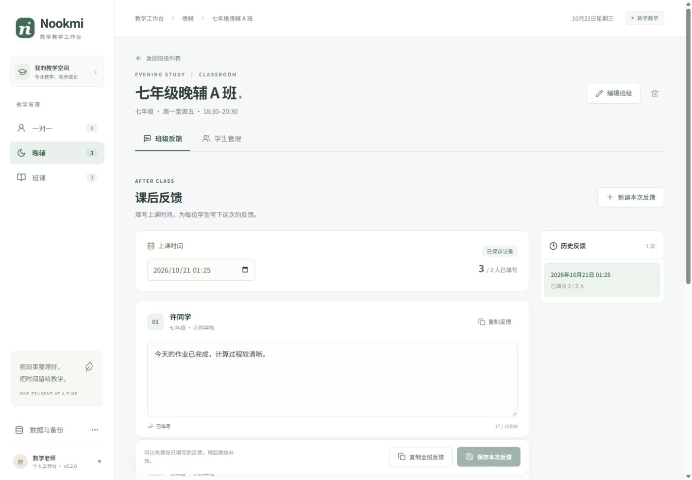
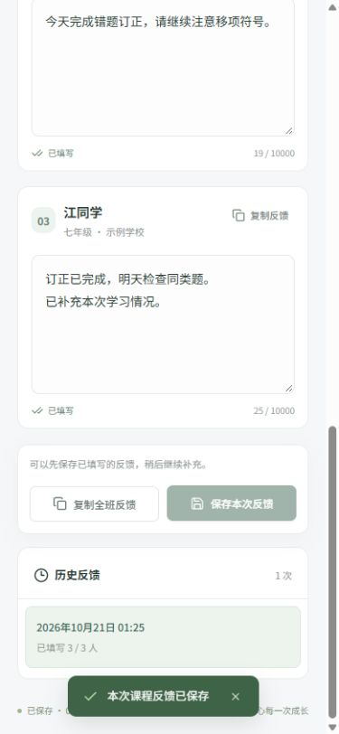
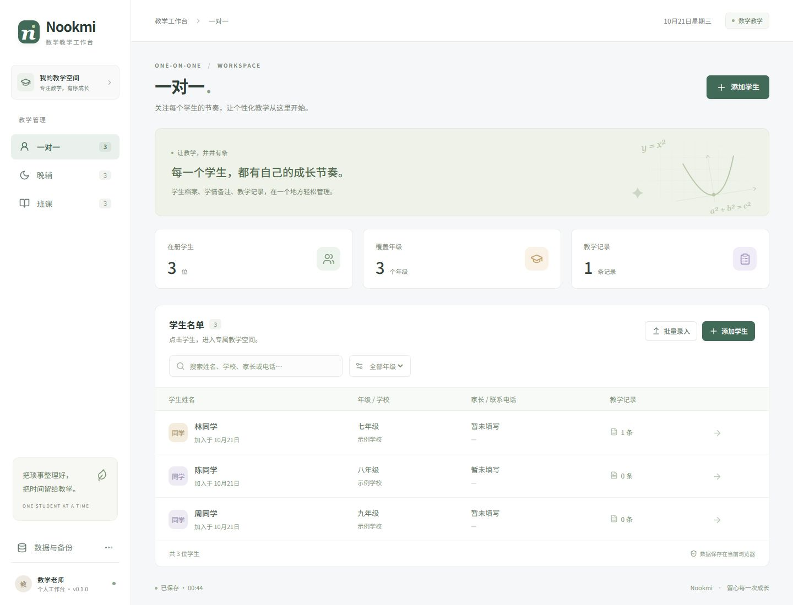
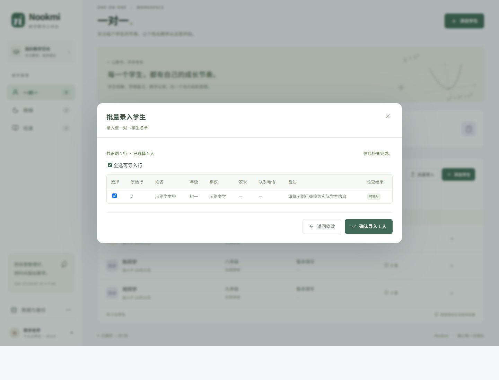
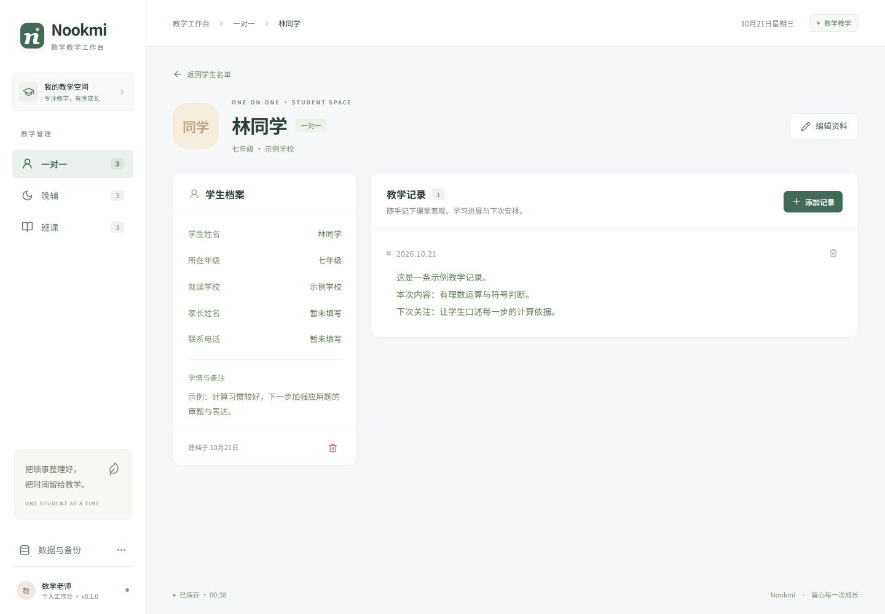

# Nookmi

**面向数学教师的一对一、晚辅与班课工作台。**

Nookmi 将学生管理与课后反馈放在同一个工作台：一对一按学生填写反馈，晚辅与班课按班级集中完成。当前版本为 **v0.2.0**，适合教师在自己的电脑浏览器中使用。



<details>
<summary>查看手机端反馈界面</summary>



</details>

<details>
<summary>查看 v0.1.0 历史界面截图（图中均为虚构示例）</summary>

以下截图展示 v0.1.0 的学生管理界面，不代表 v0.2.0 新增的反馈页面。







</details>

## 当前功能

| 模块   | 组织方式   | 已实现功能                                                                                 |
| ------ | ---------- | ------------------------------------------------------------------------------------------ |
| 一对一 | 按学生管理 | 学生个人页面默认进入课程反馈，填写时间与正文，保存、修改历史反馈并复制；保留学生档案管理   |
| 晚辅   | 按班级管理 | 班级默认进入班级反馈，同一次晚辅集中填写每位学生的反馈，支持部分完成后保存、逐人或全班复制 |
| 班课   | 按班级管理 | 班级默认进入班级反馈，同一节课集中填写每位学生的反馈，支持部分完成后保存、逐人或全班复制   |

反馈先采用自由文本，不要求固定的评价项目或模板。三个模块的数据独立组织；晚辅和班课的学生录入位于「学生管理」。原有学生资料及教学记录保留在「学生档案与笔记」，可继续查看和维护。

其他功能：

- 从 Excel 复制表格后直接粘贴，或导入 UTF-8 编码的 CSV 文件。
- 批量录入前预览数据，检查必填项、格式问题与疑似重复学生。
- 导入预览每页展示 100 行，跨页保留选择；重复项默认不选，可核对后手动选择。
- 保存后的学生、班级、教学记录和课程反馈保存在当前浏览器，刷新页面后继续使用。
- 反馈支持历史回看与修改；未保存内容在离开时提醒，复制受浏览器限制时提供手动复制文本。
- 导出 JSON 备份，并通过确认后恢复备份。
- 空工作台可载入虚构示例，快速了解操作方式。
- 支持桌面和手机尺寸的界面。

## 本地运行

需要 Node.js **22.12 或更高版本**，推荐使用 Node.js 24。

首次获取源码：

```bash
git clone https://github.com/Eternity-Top-down/Nookmi.git
cd Nookmi
```

已有项目目录时直接进入该目录，然后执行：

```bash
npm install
npm run dev
```

打开终端显示的本地地址，通常为 `http://127.0.0.1:5173`。浏览器关闭后再次启动项目，使用相同地址即可访问原有数据。

已经运行旧版时，更新源码并保持开发服务运行，然后刷新原来的页面即可查看新功能。请继续使用同一浏览器和相同地址；切换 `localhost`、`127.0.0.1` 或端口会进入不同的数据存储空间。

已有 `package-lock.json` 时，也可以使用 `npm ci` 按锁定版本安装依赖。

| 命令              | 用途                                               |
| ----------------- | -------------------------------------------------- |
| `npm run dev`     | 启动本地开发服务                                   |
| `npm test`        | 运行数据校验、反馈、批量解析和备份恢复等自动化测试 |
| `npm run build`   | TypeScript 类型检查并构建生产版本，输出到 `dist/`  |
| `npm run preview` | 本地预览构建后的版本；需要先执行构建               |

本地开发服务默认仅监听 `127.0.0.1`。此版本不包含在线部署或远程访问配置。

### 磁盘占用

当前工作目录为 `E:\WorkSpace\Nookmi`。依赖安装在项目内的 `node_modules/`，构建结果位于 `dist/`；项目 `.npmrc` 将 npm 下载缓存设置为 `.local/npm-cache/`，因此这些文件均保存在 E 盘。换位置克隆时，它们会跟随新的项目目录。`.local/`、`node_modules/` 和 `dist/` 已排除在 Git 提交之外。

浏览器中的学生信息和教学记录是文本数据，通常占用较小，但保存位置仍由浏览器的用户数据目录决定，可能位于 C 盘；上述配置不会迁移浏览器数据或保证 C 盘零占用。

## 开始使用

### 一对一

1. 进入「一对一」，新增学生并填写基本信息，姓名为必填项。
2. 点击学生，默认进入「课程反馈」，选择上课时间，直接填写自由文本反馈并保存。
3. 在历史反馈中回看、修改和复制内容。
4. 需要修改档案或查看原有教学记录时，切换到「学生档案与笔记」。

### 晚辅与班课

1. 进入对应模块，先创建班级，可填写年级、上课时间与班级备注。
2. 进入班级后，在「学生管理」中单独新增学生或批量录入。
3. 返回「班级反馈」，设置本次上课时间，在名单中分别填写各学生的反馈。
4. 可以先保存已完成的部分，随后从历史反馈中继续补写或修改；页面显示已完成数量。
5. 按需复制某位学生的反馈，或复制全班已填写的内容。空白反馈不进入复制结果。

晚辅和班课分别维护班级。同一学生参加不同模块时，在对应模块分别录入。

反馈的具体操作和当前范围见 [课程反馈使用说明](docs/FEEDBACK.md)。复制操作仅将文本放入剪贴板，后续发送由教师自行完成。

### 快速批量录入

支持以下两种来源：

- **Excel / WPS 表格：** 复制单元格区域，粘贴到批量录入框中。
- **CSV 文件：** 将表格另存为 UTF-8 编码的 CSV，再在批量录入窗口选择文件。当前不直接读取 `.xlsx` 文件。

推荐包含表头，列名如下：

```text
姓名	年级	学校	家长	联系电话	备注
示例学生甲	七年级	示例中学	示例家长		需要巩固计算
示例学生乙	七年级	示例中学			关注课堂表达
```

上面的示例使用制表符分隔，各行代表一名学生。也可以每行只粘贴一个姓名，其他信息后续补充。没有表头时，默认列顺序为：

```text
姓名、年级、学校、家长、联系电话、备注
```

粘贴或选择文件后，先检查预览中的学生和错误提示，再确认导入。疑似重复项需要核对；姓名相同不一定代表同一人。学生信息中的电话号码建议在表格中设为文本，避免电子表格软件改变前导零或格式。

## 数据保存与备份

**当前版本没有后端、登录账号或云端同步，也尚未接入 SQLite。** 学生、班级、教学记录和课程反馈保存在当前浏览器的 `localStorage` 中，键仍为 `nookmi:data:v1`。

- 不同浏览器、设备或网址端口各自保存数据，不会自动同步。
- 清除网站数据、使用隐私浏览模式，或更换浏览器，可能导致原有数据无法继续访问。
- 建议在录入较多信息后使用「导出备份」，将生成的 JSON 文件保存在自己管理的位置。
- 恢复备份会替换当前工作台数据，操作前请先导出当前数据，核对提示后再确认。
- 备份文件包含学生档案、教学记录和已保存的课程反馈，未加密，请妥善保管。
- v0.2.0 可读取原有 v0.1.0 数据和备份，无需重新录入学生。恢复旧备份仍会替换当前数据，旧备份中没有的课程反馈不会保留。

GitHub 仓库只保存程序源码。浏览器中的学生信息不会随代码提交自动上传；请勿手动将真实学生名单、备份文件、账号凭据提交到仓库。项目已忽略常见备份文件路径与 `.env` 文件。

## 项目结构

```text
Nookmi/
├─ src/
│  ├─ App.tsx          # 模块导航、班级与学生工作台
│  ├─ components.tsx   # 表单、弹窗和复用界面
│  ├─ FeedbackWorkspace.tsx # 一对一、晚辅与班课反馈工作区
│  ├─ feedback.ts      # 反馈编辑与复制内容处理
│  ├─ feedback.test.ts # 反馈功能回归测试
│  ├─ feedback.css     # 反馈工作区样式
│  ├─ data.ts          # 本地保存、批量解析与备份校验
│  ├─ data.test.ts     # 数据层自动化测试
│  ├─ routes.ts        # 模块、班级和学生的页面地址解析
│  ├─ routes.test.ts   # 路由与特殊字符回归测试
│  ├─ types.ts         # 学生、班级和教学记录的数据类型
│  ├─ styles.css       # 界面样式与响应式布局
│  └─ main.tsx         # 应用入口
├─ public/            # 静态资源
├─ docs/ACCEPTANCE.md  # 手动验收清单
├─ .github/workflows/ci.yml
├─ CHANGELOG.md       # 版本更新记录
└─ package.json
```

技术栈：React 19、TypeScript 5.7、Vite 6、Lucide 图标与 Vitest 4。

推送和提交 Pull Request 时，GitHub Actions 会安装依赖、运行测试并构建项目。本次验证结果见 [验证记录](docs/VERIFICATION.md)，后续手动交互检查见 [验收清单](docs/ACCEPTANCE.md)，版本变化见 [更新记录](CHANGELOG.md)。

## 下一步

本版先完成反馈的填写、保存、历史修改和复制流程。反馈中的具体评价项目、内容结构和模板待实际使用后再确定；课程安排、考勤、作业、错题、账号系统、SQLite 与多设备同步仍属于后续方向，**未包含在 v0.2.0 中**。
