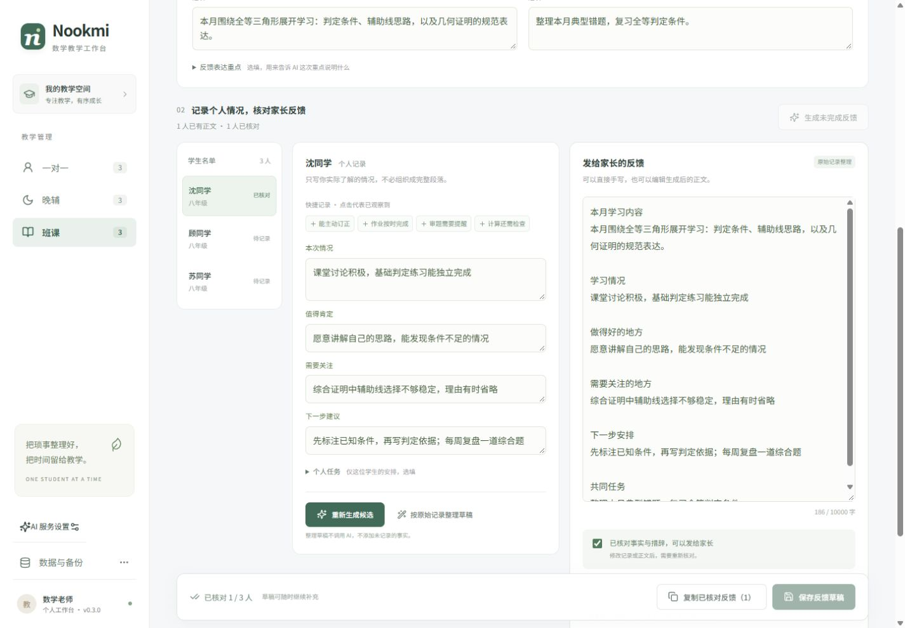

# Nookmi

**让数学教师少花时间组织语言，多保留对每位学生的具体观察。**

当前版本 **v0.3.0** 聚焦课程反馈：输入教学内容和几条真实观察，连接兼容 OpenAI 的服务生成反馈，核对、修改后复制给家长。前端采用 React / TypeScript，后端采用模块化 Python / FastAPI，资料保存在本机 SQLite。



<details>
<summary>查看手机布局</summary>


</details>

## 三种反馈流程

| 模块   | 周期                           | 填写方式                                                 |
| ------ | ------------------------------ | -------------------------------------------------------- |
| 一对一 | 每次课程，可选择上课时间       | 教学内容、课堂表现、亮点、困难、建议和任务，逐人生成     |
| 晚辅   | 每周，默认周一至周五，可修改   | 共用背景写一次；逐人记录作业、习惯、心态及分科学习情况   |
| 班课   | 每月，默认当月起止日期，可修改 | 共用阶段教学总结；逐人补充课堂表现、练习与掌握情况、建议 |

- 不必写成完整段落，关键词和短句即可；也可以直接手写正文。
- 晚辅初二默认数学、物理，初三默认数学、物理、化学，科目可自行调整。
- 班级批量生成只处理“有个人事实、尚无正文”的学生；失败可重试，已完成内容保留。
- 重新生成先展示候选与现有正文，接受后才替换；生成期间修改记录时，旧响应不会覆盖新输入。
- 原始记录、反馈正文、核对状态分别保存。只记录情况而暂不生成，也能保存草稿。
- 核对后可复制某位学生，或批量复制已核对的反馈。程序不会自动发送给家长。
- 学生、班级、批量录入、个人档案与教学笔记继续保留；历史反馈按最近编辑优先展示。

**AI 服务尚未配置时**，可以保存记录、手写正文，或使用明确标注的“按原始记录整理草稿”。后者不调用 AI，不会把关键词扩写为模型文案。

## 在本地使用

需要已安装 **Node.js 22.12+** 和 **Python 3.10+**；本次在 Node.js 24、Python 3.12 环境验证。

首次获取并准备环境：

```bash
git clone https://github.com/Eternity-Top-down/Nookmi.git
cd Nookmi
npm ci
npm run setup:backend
npm run start
```

打开 [本地工作台](http://127.0.0.1:5173/)。保留启动窗口，按 `Ctrl+C` 停止。

已有环境时，只需在项目目录执行 `npm run start`。Windows 也可以双击 **启动工作台.cmd**，再打开上面的地址。日常使用不需要编辑 TypeScript 或 Python。

`setup:backend` 会在项目内建立 `.venv`，不修改全局 Python 包。如果系统找不到 Python，可在 PowerShell 中先指定已安装的解释器：

```powershell
$env:NOOKMI_PYTHON = "E:\你的Python目录\python.exe"
npm run setup:backend
```

### 配置 AI

1. 点击侧栏「AI 服务设置」。
2. 填写服务商提供的 **Base URL、模型名称、API Key**。远程接口使用 HTTPS；本机无密钥服务可使用 HTTP 并留空密钥。
3. 点击「保存并测试连接」，成功后返回学生或班级反馈页生成。

使用兼容 OpenAI 的 `POST /chat/completions` 接口。Base URL 通常形如 `https://服务域名/v1`，程序会补齐接口路径；也接受完整的 `/chat/completions` 地址。不同服务和模型的支持范围、费用、生成效果由服务商决定。

连接测试只发送一句测试文字，可能产生少量费用。生成时发送共用内容、年级及当前学生的简短记录；程序不主动附带姓名、学校、电话或家长资料，请勿在自由文本中加入不必要的身份信息。模型仍可能出错，需要教师逐条核对。

密钥保存在本机 `.local/ai-settings.json`，不回显到页面，不包含在教学资料备份中。该配置文件未加密，请妥善保管。修改模型时密钥留空表示保留原密钥；需要删除时勾选清除。

## 数据库、迁移与备份

学生、班级、教学笔记、反馈周期、原始观察和反馈正文保存在 **`.local/nookmi.sqlite3`**。连接同一个本地后端的浏览器共用这份数据，关闭页面或重新启动程序不会清空已保存内容。

从 v0.1 / v0.2 更新：

1. 在原来的浏览器和原来的地址打开新版，并启动 Python 后端。
2. 空数据库检测到旧版浏览器资料时，会出现「迁移旧版资料」入口。
3. 迁移后保留原始浏览器副本；如果没有检测到，可在旧环境导出 JSON，再通过「数据与备份」恢复。

旧版数据属于原浏览器网址的存储空间；仅为寻找旧资料，需要沿用当时的浏览器、主机名与端口。迁移到 SQLite 后，日常资料以数据库为准。

通过「数据与备份」导出 JSON，可以包含档案、笔记、原始记录、正文与核对状态。恢复会替换当前资料，操作前先导出当前备份。只复制已保存的内容进入备份，未点击保存的编辑内容不在其中。

数据库使用事务和版本号防止两个页面互相覆盖。遇到“资料已在其他页面更新”，先保留当前输入，再重新读取数据库。

备份和数据库包含学生资料，未加密。**GitHub 只存放程序与虚构示例截图**；`.local/`、数据库、备份及密钥配置已加入忽略规则。此版没有账号系统、云同步或公网部署，只用于本机个人工作。

### 磁盘位置

本工作区位于 `E:\WorkSpace\Nookmi`。`node_modules/`、`.venv/`、`.local/npm-cache/`、`.local/pip-cache/`、安装临时目录及 SQLite 都跟随项目目录，当前位于 E 盘。浏览器自身缓存仍由浏览器管理，可能占用 C 盘。

## 学生名单录入

一对一可以添加学生或批量录入；晚辅与班课先建班，在「学生管理」中批量录入，再回到反馈页。

- 可从 Excel / WPS 复制表格直接粘贴，也可导入 UTF-8 CSV。
- 支持每行一个姓名；可用字段为 `姓名、年级、学校、家长、联系电话、备注`。
- 预览检查必填项与疑似重复项，每页显示 100 行，跨页保留选择。
- 重复项默认不勾选；同名不一定是同一人，请核对后决定。
- 电话建议设为文本；空白年级可使用当前班级年级。

## 开发与验证

| 命令                                                                | 用途                                      |
| ------------------------------------------------------------------- | ----------------------------------------- |
| `npm run setup:backend`                                             | 建立项目 Python 环境并安装后端依赖        |
| `npm run start`                                                     | 同时启动后端 8000 与前端 5173             |
| `npm run backend`                                                   | 仅启动后端                                |
| `npm run dev`                                                       | 仅启动前端，需要另行启动后端              |
| `npm test`                                                          | 前端逻辑、备份、批量录入与 API 客户端测试 |
| `npm run build`                                                     | TypeScript 检查与生产构建                 |
| `npm run preview`                                                   | 预览 `dist/`，仍需启动后端                |
| `.venv\Scripts\python.exe -m unittest discover -s backend/tests -v` | Windows 后端测试                          |

macOS / Linux 后端测试使用 `.venv/bin/python`。前端将 `/api` 代理到 `http://127.0.0.1:8000`；开发时可通过 `NOOKMI_API_URL` 调整代理目标，通过 `NOOKMI_DATA_DIR` 指定独立后端数据目录。

```text
src/
  App.tsx                 导航、学生班级管理、数据库与迁移入口
  FeedbackWorkspace.tsx   反馈编辑、批量生成、核对与历史
  feedbackModel.ts         周期、事实判定、来源签名、异步保护
  feedback.ts              复制格式与剪贴板处理
  api.ts / AISettings.tsx  后端请求与 AI 配置界面
  data.ts                 批量解析、备份校验、旧资料读取
backend/app/
  main.py                 本机 API 入口
  database.py             SQLite 表与事务
  schemas.py              输入与关联关系校验
  routes/                 工作台及 AI 接口
  services/               模型请求、提示词、配置保存
scripts/                  环境准备与启动脚本
```

本版前端 **138 项**、后端 **29 项**自动测试通过，生产构建通过。浏览器验证覆盖迁移、草稿保存刷新、模拟 AI 调用、候选比较、批量失败隔离、核对复制与响应式布局。**未接入真实模型服务，真实文案质量与具体服务兼容性待配置后试用。**

GitHub Actions 同时运行前后端测试和前端构建。本地结果见 [验证记录](docs/VERIFICATION.md)，操作见 [反馈说明](docs/FEEDBACK.md)，结构见 [架构说明](docs/ARCHITECTURE.md)，变更见 [更新记录](CHANGELOG.md)。
