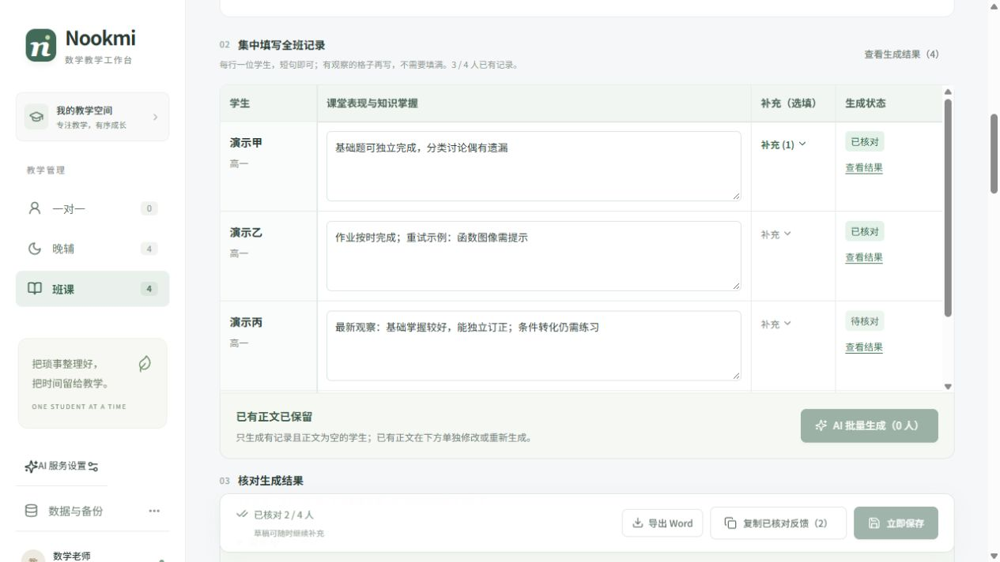
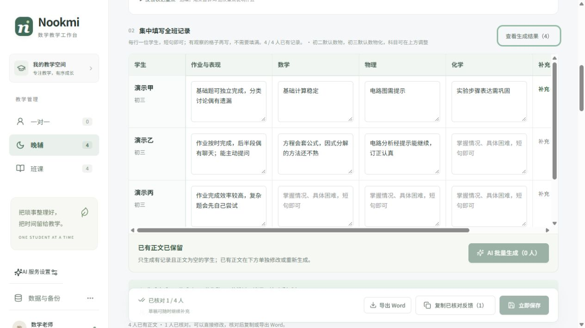
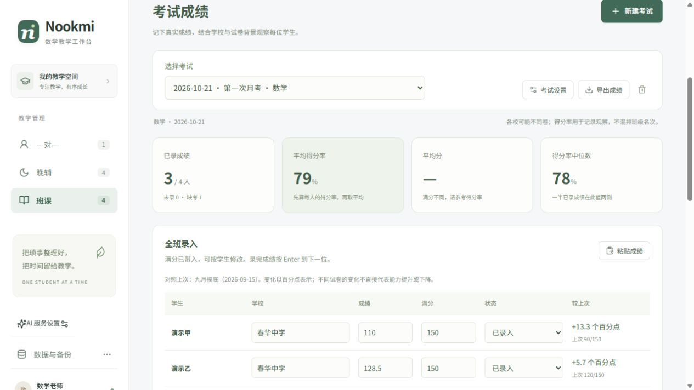

# 验证记录

## v0.13.0：并行生成、勾选重新生成与 Word 周次标题

日期：2026-10-23。本轮调整批量调度与导出标题，不修改模型提示词和单人的初稿、复核两阶段流程。

### 自动检查

- 前端 **26 个测试文件、677 项测试通过**，TypeScript 与 Vite 生产构建通过。新增检查 3 人并行上限、乱序完成即时补位、取消后不启动排队项、活动请求完成后才返回、单人失败隔离、意外异常终止队列，以及选择资格、重复/已移除学生过滤和部分选中状态。
- Word 标题测试覆盖按反馈日期而非导出日期计算、周一边界、跨周/月/年、整月、闰日、六周月份，以及旧反馈日期回退。标题保持可编辑。
- 后端 **116 项测试通过**。使用同一个应用事件循环与三方同步屏障，验证晚辅、班课的 3 个请求确实同时进入初稿阶段；每人的初稿和复核保持关联，429 和复核失败不会混入其他学生的数据，生成接口不写工作区。
- 没有安装或新增依赖；测试使用项目内 E 盘临时目录，不修改日常数据库。首次前端测试因沙箱默认 C 盘临时目录重命名受限未执行，切到 E 盘后通过全部测试。

### 隔离浏览器验证

使用 5183 / 8013 端口、`.local/qa-v13/data` 独立 SQLite 和虚构学生，模型响应由本机模拟接口提供，没有调用真实模型。

- 班课 6 人批量：前三人同时开始；第 2 人完成约 15 毫秒后第 4 人进入，没有等待首位最慢请求。模拟接口最高同时 3 个请求，一人返回 429，另外 5 人正确完成，正文按学生绑定。
- 全选已有的 5 人重新生成：在途修改一人的正文、排队时修改另一人的事实，两份旧响应都不会覆盖当前内容；一人模拟失败保留原文，两人正常替换。界面汇总为 2 成功、1 失败、2 跳过，排队时被修改的学生没有发起请求。
- 停止生成后，只发出了当时在途的 3 人请求，后续学生没有开始；迟到结果没有写回，原有正文保留。
- 晚辅 6 人同样同时启动 3 人并及时补位。随后仅勾选第 1、3 位，接口也只收到这两人的请求；全选框显示部分选中，其他学生正文保持不变。
- 重新生成后核对状态取消。只读核对隔离 SQLite：各 AI 原稿的学生和课程归属正确；之前确认的对比仍保留，新的草稿来源与当前正文一致，没有新增未采用结果列表。
- 晚辅刷新后，6 位学生的最新正文完整恢复。日常工作台已重启，健康接口确认 v0.13.0，沿用原有 SQLite；没有读取日常学生资料用于测试。
- 实际打开班课和晚辅 Word 导出，默认标题分别包含「2026年10月第4周」与对应反馈类型。将班课标题手动改为「班课验证班 2026年10月第4周 家长反馈」并下载，检查 DOCX 内标题与输入完全一致；Word 格式回归继续通过。界面截图见 [Word 标题](images/feedback-v013-word-title.png)。

### 验证边界

以上验证调度、编辑保护、保存归属和文档内容，不代表真实模型速度或反馈质量测试。每批最多 3 人；停止只中止浏览器等待和后续排队，服务端已收到的模型调用仍可能继续，随后启动新批次不构成全局并发上限。没有重做手机真机或 Word / WPS 实际分页检查。

## v0.12.0：确认采用与修改对比

日期：2026-10-22。本轮增加采用记录和对比查看，不修改 AI 提示词或服务调用流程。

### 自动检查

- 前端 **23 个测试文件、635 项测试通过**，TypeScript 与 Vite 生产构建通过。新增覆盖来源捕获、普通编辑后继续保留原稿、确认/撤销、候选替换、无 AI 原稿的旧反馈、冲突另存、输入快照不可变、备份/草稿恢复与删除。
- 后端 **114 项测试通过**。新增校验三模块的学生/课程/模块归属、长度、日期、已确认正文一致性、SQLite 重开与备份恢复、替换不累积、删除无关联活跃记录，以及损坏对比的明确提示；错误不回显实际学生内容。
- 对比算法支持中文及 Unicode 字符，测试验证可完整还原前后正文；长篇改写的计算量有上限，超过预算时按较大文本块显示。视图测试确认默认折叠、无新增填写字段、事实补充单独展示、文本按普通文字转义。
- 没有新增或安装依赖，无数据库建表迁移；测试临时目录位于 E 盘项目内。后端仍有既有 Starlette/httpx 弃用提示。

### 浏览器与保存链路

- 使用独立测试 SQLite 与模拟模型响应，在浏览器操作三个模块，没有写入日常学生数据库，也没有调用真实付费模型。
- 一对一：生成后修改正文，立即刷新仍恢复手改稿；勾选采用后展示正确的 AI 原稿与最终稿。补充事实会撤销当前核对状态并保留上次确认稿，再次确认后原始记录与更新记录分开可见；历史详情也能查看对比。
- 重新生成一份候选并选择保留原文，测试库确认没有保存该候选文本。已确认反馈只保留一份对比，没有增加课程条目或生成版本数组。
- 班课、晚辅：分别批量生成两位学生，修改一人、另一人直接采用，检查来源归属和采用稿一致。班课撤销一人的采用后，其草稿保留、对比移除，另一人不受影响；晚辅的分科记录进入对应学生的原始输入。
- 通过测试接口只读核对五位虚构学生的保存状态：原稿与学生/课程匹配，确认稿与正文匹配，弃用候选不存在。截图为实际浏览器的历史对比视图，见 [修改对比界面](images/feedback-v012-comparison.png)。
- 日常工作台重启至 v0.12.0，沿用原有 SQLite；未读取其中学生信息作测试。没有重跑真实模型内容质量评估、手机真机或 Word 分页验证，这些不属于本次对比功能的验证结论。

### 使用边界

每次每位学生最多一份当前草稿来源及一份最近确认对比；原稿是实际展示给用户的正文，不是模型内部未展示的中间结果。确认前的当前来源随草稿暂存，以支持刷新后继续修改和对比；未选候选不会归档。旧反馈缺少原稿时不会反推或补造；一对一标题单独保存，不参与正文差异高亮。当前功能只记录采用样本，不自动学习写作风格、改变提示词或训练模型。

## v0.11.0：围绕题型理解与独立推进的建议

日期：2026-10-22。修改建议指引、初稿/复核提示词、两组短示例和两处班课完整范文的建议，不改变输入字段、数据库或模型调用流程。

### 真实模型测试

- 仍通过产品的 `feedback.generate_feedback`，使用已配置的 `deepseek-flash` 进行初稿与同模型复核。仅发送固定模拟/匿名资料，没有读取真实学生数据库或已保存个人范文，公开报告不含服务地址或密钥。
- 新建 9 条直接模拟教师日常短记的题型记录：前 6 条作基线、后 3 条最初预留；多轮后均已看过，不称最终盲测。输入未因输出不理想而修改。另用 4 条旧案例检查丰富记录、个人风格、单次错误和未来计划。
- 过程保留为：基线 6 次；首轮调整 9 次；中间版 9 次及旧例回归 4 次；按“不要文字讲课”收紧后 9 次及旧例回归 4 次；针对事实措辞、交点验证和承诺问题定向回归 5 次；最后班课构造与取等问题定向回归 2 次。共 48 次反馈尝试、94 次模型调用。
- 首轮调整有 2 次初稿失败（504）、1 次复核失败保留初稿，其他轮次均得到初稿与复核结果。服务成功与内容采用程度分开统计，失败报告没有被覆盖。名称含 `final` 的早期本地文件夹只是中间版，最终两例位于 `targeted-v011-advice-focus`。
- 中间输出曾把基本不等式条件、定值构造等写成冗长讲解；收紧后仍发生一次回归。最后两例分别围绕“理解为何变形、独立选切入点”与“判断取等关系能否满足题设”给建议，不再统一讲完整最值流程。最终修改后仅对这两例定向回归，没有宣称全部 9 条或全部旧例都用同一最终提示词重测。
- 其他阶段仍见“不会选择”被弱化、同一步骤重复、“逐步撤去提示”表达趋同等问题；单模型少量固定案例不能证明整体稳定性或学生学习效果。逐条评价是 Codex 编辑审阅，不是教师验收。详见 [实际输入输出与对照](TARGETED_ADVICE_EXAMPLES.md)。

### 自动检查与使用边界

- 后端 107 项测试通过。新增整合回归覆盖三模块、两种篇幅和个人风格有无，检查新建议指引进入初稿/复核系统规则，而不改变原始事实、任务或风格消息。这类测试不证明建议内容正确。
- TypeScript 与 Vite 生产构建通过。没有改前端界面，本次未重跑前端测试全集、浏览器填写流程、Word 分页或手机真机；先前版本的结果不能当作本次新增效果验收。
- 后端测试使用 E 盘临时目录；一次受限环境重跑停住后已中断，使用允许本机套接字的环境重新全量通过。仅有既有 Starlette/httpx 弃用提示，未安装或升级依赖。
- 日常工作台加载 v0.11.0 后核对健康接口版本与前端响应。模型规则由后端启动时加载，更新代码后需要重启；仍只需输入真实情况，正常每位学生两次模型调用，已有资料沿用本机 SQLite。

## v0.10.0：少量零散记录的实际生成质量

日期：2026-10-22。本次修改提示词、内置短示例与离线评估工具，不修改填写界面、请求字段、数据库结构或模型调用阶段。

### 真实模型测试

- 使用工作台已配置的 `deepseek-flash`，通过产品的 `feedback.generate_feedback` 运行初稿与复核流程。只发送固定模拟记录及匿名范例，没有读取真实学生数据库或已保存个人范文。
- 新建 15 条独立构造的短记录：12 条先运行旧提示词作为基线，另外 3 条预留检查。根据基线调整后复测；中间版发现基本不等式建议混淆使用条件与定值构造，再收紧规则。最终版本统一重测全部 15 条及 3 条较丰富的旧案例。
- 总计基线 12 次、中间版 18 次、最终版 18 次反馈生成，实际模型请求 96 次；全部完成初稿与复核，没有检查失败回退。中间版输出保留，没有用最终结果覆盖旧报告。
- 同一批 12 条短记录逐对象核对，输入未修改；独立审阅由基线 3 例可采用、7 例轻改、2 例必须修，变为最终 8 例可采用、4 例轻改、0 例必须修。加入 3 条预留后的最终 15 例为 10 例可采用、5 例轻改。该结论是本次样本的编辑判断，不是总体合格率。
- 最终较丰富的三个案例仍保留课程清单、具体优点与困难、提示后掌握层次、来源不确定性及明确作业，没有为了缩短而压成泛泛评语。单模型少量样本不能证明长期稳定或实际省时比例，仍需教师试用核对。
- [完整对照、实际输入输出与剩余问题](SPARSE_GENERATION_EXAMPLES.md)。报告本地保存在 `.local/evals/sparse-v010-*`，Git 忽略；公开文档仅使用这些固定模拟/匿名输入输出，不包含服务地址或密钥。

### 自动检查与使用边界

- 后端 106 项测试通过，包含每模块完整与短示例的隔离、个人风格优先、初稿/复核事实完全一致、空课程与未来计划、图标适配；评估工具测试覆盖用例筛选、无效选择不读配置、草稿/终稿保留、复核失败和敏感配置不进入报告。
- 前端 19 个文件、562 项测试通过；TypeScript 和 Vite 生产构建通过。前端测试仍有既有 SVG `title` 子节点提示，后端有依赖弃用提示，均不影响本轮通过；本次没有为提示更换依赖。
- 首次后端全量测试发现旧断言仍假设两组示例，已同步为三组后重新全量通过。没有将提示词单元测试当成真实模型质量证明。
- 本次没有重跑浏览器填写、Word 分页或手机真机测试；这些界面没有改动。实际生成测试直接运行产品后端生成服务，与模拟 AI 接口的界面测试区分。
- 日常工作台重启至 v0.10.0 后以健康接口核对服务版本；SQLite 与已有反馈保持原有存储方式。更新后仍只需输入真实情况，不增加必填项，正常每次生成仍为两次模型调用。

## v0.9.0：全班表格录入与批量生成

日期：2026-10-22。本次调整晚辅、班课的输入与结果布局，复用原有生成、草稿和保存流程。没有新增依赖或数据库迁移，没有修改 AI 提示词或生成质量检查规则；后端仅同步版本号。

### 自动检查

- 前端 19 个文件、562 项测试通过，TypeScript 与 Vite 生产构建通过。
- 新增或调整的组件初始渲染测试覆盖真实表格中的全员记录、学生数据隔离、共用内容仅显示一次、旧科目记录及补充数量、只读状态、批量生成资格、修改记录后的单人状态、复制核对条件；保留一对一任务迁移和本机草稿保护检查。
- 结果入口使用按钮回调，不再添加会覆盖模块 hash 路由的页面锚点。静态测试验证按钮存在与学生对应关系；实际导航和输入焦点另在浏览器验证。
- 本次未重跑后端测试；下方 v0.8.0 的 98 项后端测试结果属于该版本记录。

### 浏览器实际操作

使用 5175 / 8002 和 `.local/qa-v09/data` 隔离数据库，全部为虚构学生，未写入日常教学数据库。AI 接口以模拟响应检查操作流程，没有调用真实模型；本次不代表生成质量评测。

- 班课四人显示在同一表格；已有正文和只有任务的学生不进入批量目标，初始按钮显示可生成 2 人。展开补充可查看之前填写的建议。
- 第一轮模拟一人失败、另一人请求延迟。失败后继续处理下一人；延迟期间修改该生记录，旧结果被跳过且新记录保留。再次批量生成，两人成功，已核对原文没有被覆盖。
- 点击表格中的「查看结果」后仍停留在原班级 hash 路由。空结果展开手写，首字输入后焦点仍在同一 textarea，继续输入完整文本正常。
- 等待静默保存后刷新，四人的原始记录、已有反馈、生成正文和手写正文均保留。核对一位学生后复制，剪贴板包含正确的学生与周期，仅包含该生正文。
- 晚辅分科填写支持 Tab 连续进入下一科。当前设置只有数学、物理时，已有非空化学记录仍保留一列；仅填写数学真实情况的学生也可以生成。三位待生成学生批量成功，原有核对正文保留。
- 检查桌面表内横向、纵向滚动，姓名列与表头保持可见；另用同源 iframe 检查 390px 宽真实工作区，主记录格可读，横向溢出限制在表格内，底部操作栏不再固定遮挡输入。这是浏览器窄宽度检查，不代表手机真机验证。
- 本轮没有重新实测 Word 文件内容、历史删除或真实 AI 输出；这些功能沿用之前实现，已有回归测试保持通过。

[查看 390px 窄窗口截图](images/feedback-v09-mobile.png)

## v0.8.0：班课考试成绩与模块概览

日期：2026-10-21。新增考试数据模型、SQLite 考试与成绩表，以及前端统计与草稿保护。没有新增依赖，没有调用模型或改动反馈生成规则。

### 自动检查

- 前端 18 个文件、557 项测试通过，TypeScript 与生产构建通过。包括考试备份与字段校验、混满分得分率、学校分组、零分/未录入/缺考区分、CSV 转义、批量粘贴预览、草稿隔离与保存期间新输入保护、模块概览边界和反馈复制。
- 考试组件初始渲染测试覆盖统计数值、学校快照与个人满分绑定、按名册顺序显示、前次同科对照、错误行保留但不计统计且禁用导出、空状态。此类测试不等同浏览器点击、自动保存计时器或真机验证。
- 后端 98 项测试通过。新增检查覆盖旧数据库自动建表及旧备份形状、小数与零分、未录入与缺考、学校快照、跨班与重复学生校验、保存后重启读取、并发写入冲突及数据库异常的整体事务回滚。

### 浏览器实际操作

使用 5175 / 8002 和 `.local/qa-v08/data` 隔离数据库，全部为虚构学生与合成记录，测试记录未写入日常教学数据库。验证后日常 5173 / 8000 服务已更新为 v0.8.0。

- 新建「第一次月考」，全班名单自动带入；粘贴三位学生成绩 108/150、128.5/150、78/100，以及一位缺考。页面显示平均得分率 78.6%，没有把不同满分混成原始平均分；分数分布、学校分组及前次同科趋势可见。
- 将保存接口延迟 3 秒：保存期间继续把 109 改为 110，等待保存后刷新，110/150、128.5/150、78/100 和缺考状态完整保留，旧保存响应没有覆盖新输入。
- 输入 130/100 后，对应行明确提示超满分，数据库不保存无效成绩；刷新后可以恢复该无效草稿继续修正。随后只粘贴姓名与 78 分，原满分 100 和考试时学校快照继续保留。
- 班课首页点击「在册学生」打开 4 人名单，搜索「秋实」后保留对应 2 人；「教学班级」按班级列出 4 人。一对一「覆盖年级」显示初三及对应学生，点击进入正确的学生页面。
- 点击「已保存课程反馈」打开 2 次有正文的历史，10 月排在 9 月之前；列表快速复制的剪贴板包含正确班名、10 月日期和 4 位学生。历史详情只读，单人复制只包含所选学生演示乙。
- 使用同源 iframe 检查 390px 宽的真实考试工作区：统计卡片双列显示，操作按钮正常换行，录分表仅在自身区域横向滚动。这是浏览器窄宽度检查，不代表手机真机验证。
- 本轮未在浏览器执行考试最终删除。删除后的关联清理及异常保护由隔离自动测试覆盖。

### 统计口径

每位学生先算「成绩 ÷ 个人满分」，平均得分率取有效已录学生的算术平均；缺考、未录入和无效分数不进入分母，真实零分参与计算。只有满分相同才显示全班原始平均分。学校汇总按学校和满分分组，学校名保留为考试时快照。

不同学校、不同试卷的得分率并不表示同等难度，不混排学生名次；历次变化仅作观察，不直接代表能力变化。60% 与 85% 是观察阈值，不能替代各校正式及格线或优秀线。

[查看得分率分布与学校汇总截图](images/exam-v08-distribution.png)

## v0.7.1：反馈字段对齐与响应式布局

日期：2026-10-21。本次调整字段标题、提示与控件布局，后端仅同步版本号；没有新增依赖，没有修改模型生成规则或数据存储逻辑。

### 自动检查

- 前端 405 项测试通过，TypeScript 与生产构建通过。本次没有新增测试。
- 未重跑后端测试；下面 v0.7.0 的后端测试结果属于该版本记录。

### 浏览器实际检查

- 在 1265px 宽的桌面浏览器中检查班课工作区，并补充检查一对一和晚辅。同行输入框与下拉框的 DOM 顶部位置一致，高度均为 44px，截图视觉检查未发现原有错位。
- 使用同源 iframe 将真实班课工作区分别设为 1041px、820px、390px 宽，检查三列、日期整行且科目与篇幅并排、单列三种布局。这是浏览器内的宽度检查，不代表手机或平板真机验证。
- 在晚辅工作区实际下载含合成资料的 Word 文档后，完成提示显示在按钮下方，工具栏按钮仍保持同行对齐。
- 本轮检查使用虚构测试资料，没有调用模型，也没有验证新的生成效果。

## v0.7.0：整班工作区、Word 导出与历史管理

日期：2026-10-21。历史功能复用现有 SQLite 记录；一对一标题新增可选字段并兼容旧课次，沿用记录 JSON 存储，旧数据无需手动迁移。没有新增依赖。

### 自动检查

- 前端 14 个文件、405 项测试通过，TypeScript 与生产构建通过。覆盖标题与十次循环、亲切称呼、时间排序、单人及全班复制、整班卡片按学生 ID 绑定、慢保存不覆盖新输入、删除范围及草稿恢复、嵌套弹窗键盘行为、Word 导出快照及接口异常。
- 后端 89 项测试通过，包含可选标题及旧课次校验、Word 文档结构/格式/换行、请求限制、友好错误与导出不改数据库。Windows 保留文件名处理补充后，6 项导出测试再次通过。
- 删除事务覆盖：本机清理失败不删除数据库；数据库失败恢复原草稿；个人反馈删除保留其他学生的内容与未同步修改；双重恢复失败返回可下载的恢复副本。
- `git diff --check` 通过。测试临时文件及合成资料留在忽略目录，没有写入日常数据库。

### 浏览器实际操作

使用 5175 / 8002 和 `.local/qa-v07/data` 隔离数据库，全部为虚构学生与合成反馈，不调用模型。测试后已关闭隔离页面及服务。

- 将隔离接口每次保存延迟 5 秒：自动保存期间没有全屏遮罩，输入框保持可编辑；保存发出后继续追加文字，等待保存并刷新，追加内容仍完整保留。
- 当前草稿的保存状态在页面内显示，不再反复插入/移除下方的“本机未同步草稿”卡片；本机暂存及写入锁仍保留。
- 一对一、晚辅与班课均显示时间倒序的历史列表。较早课次即使编辑时间更晚，仍排在较新课次之后。
- 一对一在当前记录有新输入时查看另一条历史，详情呈现该条已保存的教学信息、正文和原始填写记录；关闭后当前输入保留。历史快速复制的剪贴板中是所选课次的日期与正文。
- 班课列表复制本次全班反馈：剪贴板含两位学生，待核对正文没有被漏掉，页面提示检查后发送；详情内单人复制只含该学生，点击继续编辑回到所选周期。
- 班课学生个人页按周期倒序，快速复制只含所选学生，没有混入同班其他学生；晚辅批量复制的标题、周期及两位学生正文正确。
- 晚辅和班课两位学生的记录与正文在同页同时展开；班课直接连续编辑两位学生，等待自动保存后刷新，两人的记录分别保留，没有切换学生。
- 一对一使用可直接编辑的完整标题；根据最近上课时间接续，最近为第 8 次时新建为第 9 次，最近改为第 10 次并保存后新建为第 1 次。无效旧课次本机草稿可以通过新标题界面继续保存，不再因隐藏字段报错。
- 历史删除确认显示对应周期及全班范围，取消后资料仍在；删除实际数据变更及异常回滚由隔离单元测试验证，没有在浏览器执行最终不可撤销删除。
- 班课当前工作区输入自定标题后，实际下载 `班课验证班十月数学反馈.docx`；待核对的两位学生均包含在文件内。历史详情也能打开 Word 标题弹窗，按 Escape 只关闭导出弹窗，原历史详情保留。
- 界面截图均为虚构资料：[整班工作区](images/feedback-v07-batch.png)、[历史反馈列表](images/feedback-v07-history.png)、[可编辑标题](images/feedback-v07-title.png)。

### Word 内容与格式

合成晚辅 3 人、班课 6 人的 DOCX 经 `python-docx` 与 OOXML 核对：标题与正文均显式指定宋体 12 磅，姓名加粗、正文不加粗；按「姓名：反馈」排列，原换行和空行保留，A4 页面。浏览器实际下载的文件也重新读取文档 XML，确认自定义标题、两位学生及正文完整，所有文本使用宋体和 24 半磅（即 12 磅），姓名粗体。

已尝试技能自带渲染程序，但本次 Windows 依赖包没有 LibreOffice，报 `soffice.exe not found`，因此未生成页面预览，**Word / WPS 实际打开后的分页和视觉效果尚未验证**。没有安装新依赖，也未调用用户自行安装的文档渲染程序。

### 验证边界

本版未改生成提示词或模型服务，未再次调用真实模型评估生成质量。新称呼规则通过本机函数测试验证，不代表模型每次都严格使用占位称呼。没有重新执行移动端、剪贴板权限拒绝、断网或多标签冲突的浏览器流程；相关已有逻辑回归由自动测试覆盖。界面与自动检查通过不代表“生成质量稳定优秀”已经达成，后续需继续以真实试用中的事实准确性、修改量和填写时间验证。

日常后端已重启，通过 5173 前端代理读取健康状态为 `0.7.0`。日常学生数据库没有写入测试资料。

## v0.6.1：个人风格优先与一对一图标搭配

日期：2026-10-21。没有增加输入字段、模型调用阶段或数据库结构。

### 自动检查

- 前端 9 个文件、318 项通过；风格编辑界面沿用既有保存流程，更新说明与徽标文案。
- 后端全量 75 项通过。覆盖有个人范文时移除内置成对示例及固定结构、初稿与复核共享事实边界、无图标范文不添加图标、两个个人标题不被扩为四个、日期变化选择不同搭配、重试与修改观察时选择稳定、原示例不被修改。
- 13 个匿名案例 dry-run 通过；生产构建和 `git diff --check` 通过。
- 日常 Python 后端已重启，从 5173 前端代理读取的版本为 `0.6.1`。

### 实际模型核对

使用已有配置的 `deepseek-flash`，先生成 6 个案例，再复测个人班课标题并新增相邻日期图标变体，共 8 次完整生成、16 次模型调用。每例均完成初稿和复核，耗时约 7.4–29.3 秒，没有触发复核失败回退。只使用固定匿名或虚构资料，不读取日常学生档案和个人范文。

- 一对一纯文字范文生成两段自然文字，没有强加图标、编号或四板块。
- 晚辅保留“· 本周看到的／· 下一步”的短分点；没有借范文补写本次未观察的化学表现。
- 班课沿用三个自定义标题与教师语气。首轮额外增加了范文没有的 Markdown 加粗，补充格式约束后针对复测恢复纯文字标题。
- 个人一对一两标题写法保持两个标题，使用含义相近图标，没有扩成默认四部分。
- 默认一对一相同事实在10月4日使用 📖／✨／🔍／📌，仅将日期改成10月5日后使用 📚／🔎／💡／📝；这是合成的日期变化验证，不代表两次真实授课。
- 稀疏记录仅输出实际观察，没有为图标或范文长度补造段落。抽查未发现旧范文的姓名、成绩、课程和表现迁入本次事实。

实际原始输出见 [个人风格示例](STYLE_EXAMPLES.md)。本轮由 Codex 与独立审阅代理对照输入检查，尚未由教师用户或家长验收；不能据此保证所有个人写法均能精确复现，也不能证明家长感知的“AI 感”已降低。默认四组图标的选择由单元测试覆盖，其中两组完成了真实模型输出对照；未对所有组合逐一调用模型。

本次未新增浏览器全流程回归，界面仅改文案，已有流程参见 v0.6.0；本轮数据保存与接口回归由隔离测试覆盖。

## v0.6.0：精选范文与生成质量

日期：2026-10-21。内置六组匿名范例，每模块两组；没有新增填写必填项或数据库结构。真实模型测试只使用匿名重建记录或虚构边界案例，不读取日常学生数据库。

### 自动检查

- 前端 `npm test`：9 个文件、318 项通过，包括姓名占位替换、超长保护、复核提示汇总及生成/连接测试各自的超时边界。
- Python 后端全量 72 项通过，包括三模块事实与风格隔离、两阶段生成、第二次失败保留初稿、首次失败不再复核、不泄露上游诊断，以及生成接口不写入工作区。
- 固定 8 个案例的 dry-run 校验通过，不读取 AI 配置或调用模型；生产构建与 `git diff --check` 通过。
- 日常 Python 后端已重启，从 5173 前端代理读取健康状态确认为 `0.6.0`；隔离 QA 前后端已退出。

### 真实模型输出核对

使用已有配置的 `deepseek-flash`。前三轮单阶段试验共 21 次调用，发现数学建议泛化、未给定原因与审核式措辞等问题。随后加入后台复核，对完整 8 例测试（16 次调用），再针对 3 例修正复测（6 次调用），本轮共 43 次实际调用。最后两轮每例均完成初稿和复核，没有触发失败回退。

- 完整 8 例两阶段耗时约 7.7–25.6 秒，中位数约 13.6 秒；最终针对 3 例为 7.6–31.5 秒。不是速度承诺，批量按学生串行处理。
- 程序执行成功、提示词断言和模型复核不等于质量通过。以下是 Codex 与独立审阅代理逐条对照输入的结果，尚未由教师用户验收。
- 最终抽查保留了概率方案比较的目标、独立完成与提示后完成的区别、学科边界、进步原因的不确定性及未来计划；稀疏记录没有借范文补造课程、作业或学生表现。
- 针对复测修正了数列建议遗漏公差为零的特殊情况、作商比较未说明分母非零、完成一小段后聊天的纪律建议和无依据性别代词。
- 仍有少量重复与审核口吻。例如不确定观察案例仍保留了“还缺少充分的作业情况作为依据”，虽来自记录，但发给家长时可再调顺。自动复核不能保证每次输出正确或无需修改。

代表结果见 [实际生成示例](GENERATION_EXAMPLES.md)。本地完整报告位于 `.local/evals/`，不进入仓库；固定案例和复测命令在 [评估说明](../backend/evals/README.md)。输入由认可成稿逆向提炼，不能据此宣称已证明真实填写时间、返工量或家长满意度改善。

### 浏览器与持久化

使用 5175 / 8002 和 `.local/qa-v06/data` 隔离数据库。浏览器回放完整 8 例轮次中的实际输出，不再次调用模型。

- 一对一显示默认“按范文完整展开”和“已用内置范文”，原来的主框与选填补充继续可用；生成后 `【学生】` 被本机学生称呼替换。
- 一对一刷新后课程内容、观察、任务和生成正文恢复，显示已存数据库。
- 晚辅与班课的“生成未完成反馈”入口分别生成当前虚构学生的正文，保持未核对状态。接口读取确认三模块正文已保存且无剩余占位称呼。
- 截图为虚构班课学生与实际模型输出回放：[反馈界面](images/feedback-v06-example.png)。没有使用日常学生资料。
- 复核失败提示由接口、服务与前端函数测试覆盖；本轮没有重新做浏览器多学生部分失败、移动端或剪贴板全流程。先前保存/删除等结果参见下方对应版本，不能作为本次新增行为的浏览器验收。

## v0.5.0：自动保存、本机草稿与删除入口

记录日期：2026-10-21。浏览器回归使用 5175 前端、8002 后端与 `.local/qa-v05` 隔离数据库，全部为虚构资料，不调用真实模型。

### 自动检查

- `npm test`：9 个文件、299 项通过。包括反馈草稿恢复、范围隔离、原始学科文字、存储错误、删除学生时保留其他学生与班级共用内容，以及风格范文暂存与冲突。
- Python 后端全量 62 项通过。包括已移除推荐接口返回 404 且不调用模型、三模块混写观察与未来建议的提示词约束，以及风格与事实隔离。提示词断言不等于真实模型输出质量验收。
- `npm run build` 与 `git diff --check` 通过。
- 日常 Python 后端已重启；从 5173 前端代理读取到版本 `0.5.0`，移除的推荐接口返回 404。日常数据库没有写入测试资料。

### 浏览器实际操作

- 一对一输入课程内容、学生观察与已编辑正文，清空上课时间后立即刷新：日期仍为空，三处文字均恢复，错误明确定位到日期；修正后自动保存。
- 晚辅共用内容只填一次，分别填写甲、乙两人的观察和正文，立即刷新后恢复乙的选择及内容；接口读取确认两人的正文和共用内容均已写入 SQLite。
- 新建第二次一对一反馈，未填日期时切换到已保存历史，再切回本机草稿，两个课次内容各自保留，没有错误的冲突提示。
- 停止隔离后端后编辑有效日期、观察与正文，页面明确显示本机已保留、数据库暂未保存。后端恢复后刷新，文字恢复且自动同步；读取隔离数据库确认正文已保存。
- 一个主框可记录真实要点，细分字段折叠为选填。页面没有 AI 推荐记录入口。
- 学生名单显示快捷删除按钮，点击后出现一次确认与影响说明，取消后学生保留。本轮没有在浏览器执行不可撤销的最终删除。

截图：[主输入区](images/feedback-v05-input.png)、[数据库保存状态](images/feedback-v05-drafts.png)。图中正文为手工填写的测试文字，不是模型生成效果。

### 验证边界

本轮未完整重做手机交互、真实模型输出、多窗口版本冲突处理、故意延迟保存响应、风格编辑的浏览器恢复和整库备份恢复；相关边界主要通过单元测试及代码检查覆盖。后端离线时刷新会进入连接失败页，需要服务恢复后才能加载工作台；本机草稿不会因此被清空。草稿限定同浏览器同地址，清除浏览器数据会删除未同步文字。下方 v0.4.x 的推荐功能和截图均为历史记录，已不属于当前功能。

## v0.4.1：旧后端识别与校验提示

历史版本记录；推荐接口相关检查不表示 v0.5.0 仍提供推荐功能。

验证日期：2026-10-21。日常工作台只读取健康状态、数据库版本与记录数量；保存回归使用独立数据目录和 8002 / 5175 端口，不调用真实模型。

### 已确认的原因

- 用户使用新版前端时，8000 端口仍运行 v0.3 后端；该进程没有 AI 推荐路由，请求返回 404 / `Not Found`。
- 新版生成请求带有 `styleReference`，工作台保存包含 `feedbackStyles`。旧后端禁止额外字段，会以 422 拒绝这些新版字段，原提示不足以定位原因。
- 仅刷新前端页面不能更新运行中的 Python 后端，需要停止旧进程并重新启动。

### 修复回归结果

- `npm test`：8 个文件、276 项通过；覆盖推荐 404 的 JSON / HTML 响应、空缺或反向日期、科目限制、具体字段长度、个人事实门槛及修正后解除禁用。
- Python 后端全量 71 项通过；覆盖字段提示、选填内容、动态科目名、额外字段名和密钥等敏感内容不回显。
- `npm run build`、`node --check scripts/start.mjs` 与 `git diff --check` 通过。
- 重启后，从日常页面代理 `/api/health` 读取到 `version: 0.4.1`，数据库版本与学生、班级、反馈数量与重启前一致。
- 日常推荐路由使用虚构的无效日期请求，返回具体的「反馈开始日期」规则，未调用模型。隔离环境的有效请求通过新版字段校验，进入模型配置检查并返回预期 503；测试环境没有模型配置。
- 隔离数据库成功保存新版 `feedbackStyles`，返回新版本号及保存的参考。未向日常数据库写入测试资料。
- 运行重复启动检查时，启动器提示端口占用并退出，日常工作台继续响应。隔离启动器正常启动前后端；结束其测试前端后，退出清理一并释放 8002、5175，未留下实际 Python 解释器。

### 验证边界

本次没有重新进行完整浏览器操作或真实模型效果测试；界面提示由组件渲染测试与接口检查验证。Windows 退出清理通过测试前端退出触发，未逐一模拟所有控制台关闭方式。README 中的推荐界面截图仍标为 v0.4.0 历史示例。

## v0.4.0：个人风格、动态推荐与单人课程修正

历史版本记录；AI 推荐记录在 v0.5.0 已移除，截图仅用于说明当时的验证。

验证日期：2026-10-21。继续使用隔离前端 5175、后端 8001、`.local/qa-v03` 虚构数据，以及本机 8011 模拟接口。未向真实模型发送资料。

### 自动检查

- `npm test`：8 个文件，255 项全部通过。新增覆盖一对一历史双任务无损合并、三模块表单差异、风格备份与签名兼容、范文编辑/撤销/外部更新、推荐输入变化与旧结果失效、候选手动加入和 API 校验。
- `.venv\Scripts\python.exe -m unittest discover -s backend/tests -v`：58 项通过。新增覆盖风格独立存储、事务与版本冲突、旧备份、提示词范文/事实隔离、建议 JSON 与围栏解析、数量/字段/长度限制、无个人事实拒绝及上游响应隐私处理。
- `npm run build` 与 `git diff --check` 通过。

### 浏览器实际操作

- 一对一只有一个展开的课后任务框，页面没有班级共用任务/个人任务区分。
- 先输入课堂记录，再保存个人风格：课堂草稿未丢失；参考未保存时 AI 按钮禁用，保存后恢复。
- 获取推荐后显示有分类的候选卡片，点击后续建议只加入建议栏，本轮候选清空。
- 模拟生成响应确认收到了本次事实与独立风格参考；保存后刷新，课程内容、建议、任务、正文和已设置的风格均保留。
- 再获取推荐并修改观察，旧推荐立即清除，现有反馈正文保留并提示生成依据更新。
- 切换晚辅班级，风格状态为未设置，没有串用一对一参考；班级仍显示共同任务与个人任务。

截图：[动态推荐与正文](images/feedback-v04-suggestions.png)。截图为模拟接口响应，不能证明真实模型的措辞质量。

### 验证边界

本次浏览器核对为桌面布局；手机交互未重新完整验收。真实模型的文风贴合程度、事实遵循及推荐实用性尚待用户配置 API 后试用。旧版数据极限长度与多模块隔离主要由自动测试验证。

## v0.3.0：真实记录、AI 辅助与 SQLite

验证日期：2026-10-21。环境：Windows，Node.js 24、Python 3.12。浏览器使用隔离前端 5175、后端 8001，以及 `.local/qa-v03` 测试数据库。全部为虚构资料。AI 联调使用本机 8011 端口的模拟 Chat Completions 服务，不调用真实付费模型。

### 自动检查

- `npm test`：5 个文件、138 项测试通过。覆盖批量录入、旧新版备份、原始观察与共用内容、周期与分科默认、空草稿、事实判定、来源签名、异步结果保护、最近编辑排序、API 错误及取消。
- `.venv\Scripts\python.exe -m unittest discover -s backend/tests -v`：29 项通过。覆盖 SQLite 持久化与重启读取、事务回滚、版本冲突、旧新版数据、关联和日期校验、配置与密钥处理、本机访问限制、模拟上游失败/超时/无效内容。
- `npm run build`：TypeScript 与 Vite 生产构建通过；启动脚本语法检查和 `git diff --check` 通过。

### 浏览器实际操作

- 将旧版浏览器中的 9 位学生、2 个班级和 4 次反馈迁入 SQLite；原始副本入口保留。
- 一对一只保存简短观察和共用教学内容，刷新后仍保留。未配置服务时生成得到明确提示，不清空输入。
- 在 AI 设置页配置本机无密钥模拟接口，保存并测试连接成功；单人生成进入正文。
- 人工修改正文、勾选核对并复制，实际读取剪贴板确认姓名、时间与正文；修改原始记录后核对状态取消，旧正文保留并提示更新。
- 重新生成展示旧正文与新候选，可保留原文；原始记录整理明确显示非 AI 来源，可接受候选替换。
- 晚辅批量中 1 人成功、1 人模拟 429 失败，无记录学生不参与。重试只处理尚无正文者，已成功反馈保留。
- 模拟延迟生成期间修改个人记录，返回内容被跳过，未覆盖最新输入；随后可按新记录重试。
- 批量复制实际只包含已核对的 1 位学生，周反馈周期为 2026.10.19—2026.10.23。
- 班课月反馈默认 2026.10.01—2026.10.31，共用内容填写一次；个人观察、正文、核对状态分别保存。
- 修复旧单次课程排在新月反馈前的问题后，刷新默认打开最近保存的月反馈，正文和仅记录观察的学生数据均保留。
- 已保存草稿生成中跨模块会提醒，取消离开后继续保留内容；停止生成后，延迟返回不写入正文。
- 实际下载 JSON 备份，确认其中有 9 位学生、2 个班级、7 次反馈，以及 brief、observations、reviewed、generatedFrom；不含 AI 配置或密钥。
- 桌面 1440 × 1000、手机 390 × 844 均无页面整体横向溢出；手机切换学生、填写个人记录并保存成功。
- 正式地址 5173 全刷新后没有浏览器错误或警告。开发中曾有一次热更新改变 effect 依赖数组长度的提示，完整刷新后未复现。
- `npm run start` 实际同时启动 Python 8000 和前端 5173；停止后两个监听端口释放，再启动成功。正式数据库未写入测试资料。

截图：[桌面](images/feedback-v03-desktop.jpg)、[手机](images/feedback-v03-mobile.jpg)。展示虚构学生及非 AI 的原始记录整理，不能视为真实模型输出效果。

### 验证边界

未提供真实服务配置，因此真实模型的文案质量、费用和具体服务兼容性未验收。本版未重跑全部旧版学生增删改操作，未在浏览器重做完整备份恢复、多浏览器冲突或长时间大量数据验证；相应数据、恢复和版本冲突逻辑有自动测试覆盖。手机检查属于浏览器尺寸模拟，不代表实体手机测试。GitHub Actions 的远程执行结果需以仓库实际运行记录为准。

## v0.2.0：课程反馈

验证日期：2026-10-21。浏览器检查使用独立测试地址 `http://127.0.0.1:5175` 和虚构数据，与日常使用地址的数据分开。

### 自动检查

- `npm test`：3 个测试文件、98 项测试通过，覆盖反馈文本与时间、备份校验及兼容、批量录入、本地保存和页面地址解析。
- `npm run build`：TypeScript 检查与 Vite 生产构建通过。

### 浏览器实际操作

在应用内浏览器完成以下验证：

- 一对一新建两次反馈，修改原有课程的上课时间为 19:30；刷新后时间和正文保留，历史记录没有重复新增。
- 复制一对一反馈，核对学生、上课时间和正文正确。
- 有未保存修改时，切换页签和跨模块均出现确认；取消后文字保留，确认放弃后可以继续跳转。
- 晚辅先为 3 位学生中的 2 位保存反馈，刷新后仍显示 2/3；逐人复制不包含同学内容，全班复制仅包含 2 位非空反馈。
- 补写晚辅第 3 位学生后，更新原有课程记录；进入学生个人页面可以查看该学生自己的反馈。
- 班课完成 1/3 后保存并刷新，反馈保留，与晚辅数据相互独立。
- 实际下载 JSON 备份，导出时核对其中含 9 位学生、2 个班级、4 次课程反馈及 6 条非空学生反馈。
- 桌面 1440 × 1000 与手机 390 × 844 尺寸检查没有页面整体横向溢出；手机界面补写反馈并保存成功。
- 检查期间未发现页面控制台错误或警告。

本版截图：[桌面班级反馈](images/feedback-class-desktop.jpg)、[手机班级反馈](images/feedback-class-mobile.jpg)。图中数据均为虚构示例。

### 范围

本次以反馈流程为主，未重新执行 v0.1.0 的全部学生、班级增删改流程，也未在浏览器中重做完整备份恢复或多浏览器验证。剪贴板不可用的处理、旧备份兼容与异常数据校验有自动化测试覆盖；下方保留的 v0.1.0 结果属于历史验证记录。

完整操作步骤见 [手动验收清单](ACCEPTANCE.md)，功能说明见 [课程反馈使用说明](FEEDBACK.md)。

## v0.1.0：学生与班级管理（历史记录）

验证日期：2026-10-21。测试数据均为程序生成的虚构示例和测试姓名。

### 自动检查

- `npm test`：71 项测试通过，覆盖批量 CSV / TSV 解析、表头校验、重复检测、备份字段与关联关系校验、存储错误和页面地址解析。
- `npm run build`：TypeScript 检查与 Vite 生产构建通过。
- `npm audit --audit-level=moderate`：0 个已知依赖漏洞。

### 浏览器实际操作

在本地浏览器中完成以下验证：

- 一对一新增学生、修改档案、点击进入个人空间、添加教学记录，刷新后资料和记录仍保留。
- 纯空格姓名被拒绝；只填写姓名可以保存。
- 晚辅、班课各自创建班级，班级数据彼此独立，学生能进入对应个人页面。
- 从 Excel 格式文本批量粘贴，空白年级采用班级默认值。
- 预览识别重复行与缺失姓名行；默认仅勾选有效且不重复的行，确认后数量正确。
- 班课支持每行一个姓名的快速录入；搜索能筛出指定学生。
- 下载 CSV 模板，再通过文件选择器读取，中文与各字段解析正确。
- 编辑班级时间并保存；删除确认展示关联学生数量，取消保留数据，确认只删除目标班级及其学生。
- JSON 备份实际下载成功，通过文件选择器恢复后，班级、学生和教学记录数量一致。
- 清空功能需要确认；清空后可重新载入虚构示例。
- 桌面 1440 × 1000 与手机 390 × 844 布局检查通过。手机导航、学生表单、空姓名校验与个人空间可用，页面没有整体横向溢出。
- 检查期间未发现页面控制台错误。
- `npm run preview` 启动的生产构建可打开，载入虚构示例并进入学生个人页面正常。

本版历史截图为 `docs/images/one-to-one.jpg`、`bulk-import.jpg` 与 `student-space.jpg`。`ACCEPTANCE.md` 是供后续版本重复使用的完整验收清单，未勾选项不代表这里的所有项目均未执行。

### 范围

尚未验证多种真实浏览器、真实 Excel / WPS 剪贴板来源、长期大规模教学数据或多设备协作。浏览器存储不可用、容量不足和畸形备份通过自动化测试覆盖。
